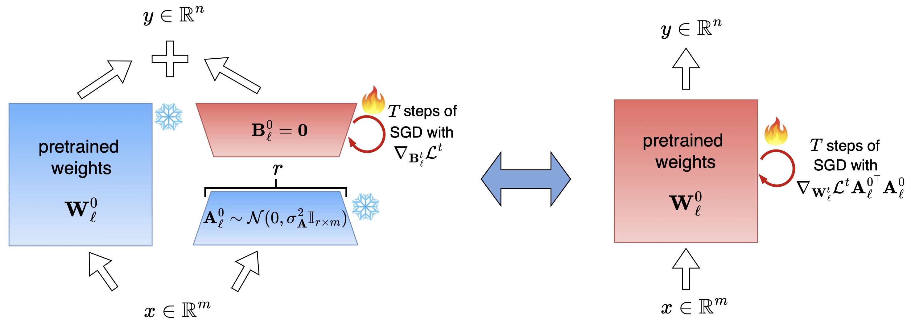

# SPRA-LoRA: Stochastic Projections and Rank-Aware Learning Rates for Federated LoRA

## 📌 TL;DR
SPRA-LoRA is a parameter-efficient federated fine-tuning framework for Large Language Models. It freezes and periodically resamples random projection matrices while dynamically scaling learning rates based on client adaptation ranks, significantly reducing communication overhead while maintaining model performance.

---

## 🎨 Overview & Architecture

<p align="center">
  
</p>

> *Figure 1: High-level overview of the SPRA-LoRA architecture, depicting stochastic projection resampling requiring rank-aware learning rates across clients.*

---

## 📁 Repository Structure

```text
.
├── Common Sense/                      # Implementation codes and files for the Common Sense dataset
├── Figures/                           # Figures and visual assets for documentation
├── GLUE/                              # Implementation codes and files for the GLUE benchmark
├── plots/                             # Codes used for plotting the figures in the paper
├── Commonsense_requirements.text      # Required Python packages for the Common Sense implementation
├── GLUE_requirements.text             # Required Python packages for the GLUE implementation
└── README.md                          # Repository documentation
```

### Subdirectory Explanations
* **[GLUE](GLUE/)**: The implementation codes for the GLUE benchmark are located in the GLUE subfolder.
* **[CommonSense](Common-Sense/)**: The implementation codes for the CommonsenseQA dataset are located in the Common Sense subfolder.


## 📚 Citation
We built this repository by extending the repositories of the **[FSLoRA](https://arxiv.org/pdf/2501.19389v4)** and **[LA-LoRA](https://arxiv.org/pdf/2602.19926)** papers. If you find this work or repository useful in your research, please cite our paper:

```bibtex
@inproceedings{
spralora,
title={Stochastic Projections and Rank-Aware Learning Rates for Federated LoRA},
author={Saber Malekmohammadi and Kevin Kuo and Virginia Smith and Golnoosh Farnadi},
booktitle={The Fortieth Annual Conference on Neural Information Processing Systems},
year={2026},
url={[https://openreview.net/forum?id=uPdmJxDBM2](https://openreview.net/forum?id=uPdmJxDBM2)}
}
